<a href="https://muhidinm.vercel.app">
  
</a>

<p align="center">
  <a href="https://muhidinm.vercel.app"></a>
  <a href="https://www.linkedin.com/in/muhidinm"></a>
  <a href="mailto:misbahmuhidin@gmail.com"></a>
  <a href="https://muhidinm.vercel.app/MuhidinMisbah.pdf"></a>
</p>

### ⚡ Why I build

Plenty of people here have never had a loan. Some won't take one with interest; many small shops can't show a bank the paperwork it wants. I spend my days on the software that changes that: **interest-free financing**, **revenue-based loans for small businesses**, and the **national zakat platform** — and I care as much about the Kubernetes cluster under them as about the button a first-time borrower taps.

On the side I build AI products with VK Tech, where the tools I've shipped are used by **150K+ people**.

<!-- <p align="center">
  
</p> -->

### 🧪 Right now

```ts
const muhidin = {
  role: "Senior Software Engineer, Payments Platform Innovation @ Coop Bank of Oromia · DxValley",
  sideQuest: "Frontend engineer @ VK Tech — multi-tenant SaaS & AI media",
  shipping: ["payments", "Next.js frontends", "NestJS APIs", "Kubernetes CI/CD"],
  believes: "the best UI is the one a first-time user never has to think about",
  askMeAbout: ["Next.js", "TypeScript", "fintech UX", "getting things into production"],
};
```

### 🗂️ Things I've shipped

<table>
  <tr>
    <td width="50%"><a href="https://muhidinm.vercel.app/#projects"></a></td>
    <td width="50%"><a href="https://muhidinm.vercel.app/#projects"></a></td>
  </tr>
  <tr>
    <td width="50%"><a href="https://muhidinm.vercel.app/#projects"></a></td>
    <td width="50%"><a href="https://muhidinm.vercel.app/#projects"></a></td>
  </tr>
  <tr>
    <td width="50%"><a href="https://muhidinm.vercel.app/#projects"></a></td>
    <td width="50%"><a href="https://muhidinm.vercel.app/#projects"></a></td>
  </tr>
</table>

<p align="center"><a href="https://muhidinm.vercel.app/#projects"><b>Open the folders — case studies on the portfolio →</b></a></p>

### 🛠️ Stack

<p align="center">
  <b>Frontend</b><br/>
  
</p>
<p align="center">
  <b>Backend & data</b><br/>
  
</p>
<p align="center">
  <b>Infrastructure & observability</b><br/>
  
</p>

### 📊 GitHub stats

<p align="center">
  
  
</p>
<p align="center">
  
</p>

### 🎓 Education

- **B.Sc. Computer Science and Engineering** — Adama Science and Technology University, 2022
- **DevOps, Cloud, and Agile Foundations** — IBM · [Coursera](https://www.coursera.org/account/accomplishments/specialization/4GZZDYM5YEAW)


